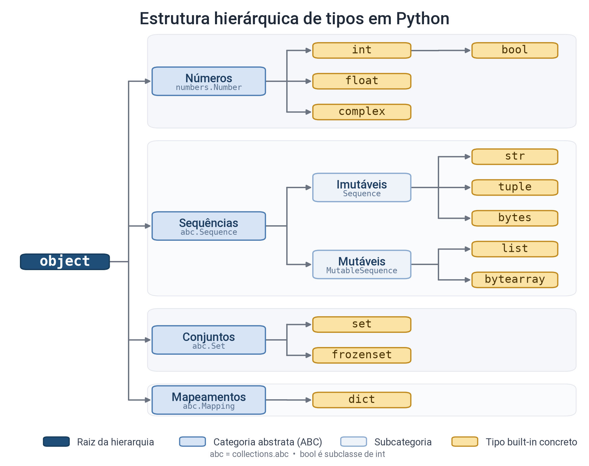
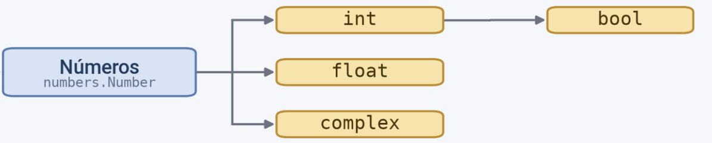

{::nomarkdown}
template: inverse

# Revisitando tipos em Python

---

## Hierarquia de tipos



---

## Números

- int e bool
- float
- complex



---

## Tipos int e bool

Os tipos bool e int são compatíveis em Python.
- O tipo bool é uma subclasse do tipo int.

- Valores numéricos equivalentes
  - O valor True equivale a 1 
  - O valor False equivale a 0.

- Operações matemáticas

```python
True + 3    # resulta em 4 (1 + 3 = 4)

False * 10  # resulta em 0 (0 × 10 = 0)
```

---

## Números complexos

Um número complexo é aquele que possui uma parte real e uma parte imaginária.

- parte imaginária: uso de 'j'

``` python
# Forma 1: sintaxe direta (literal)

num1 = 3 + 4j

# Forma 2: função complex(real, imaginario)

num2 = complex(3, 4)

# As duas formas resultam no mesmo valor: (3+4j)

print(num1 == num2)  # Retorna True

```

{:/}

