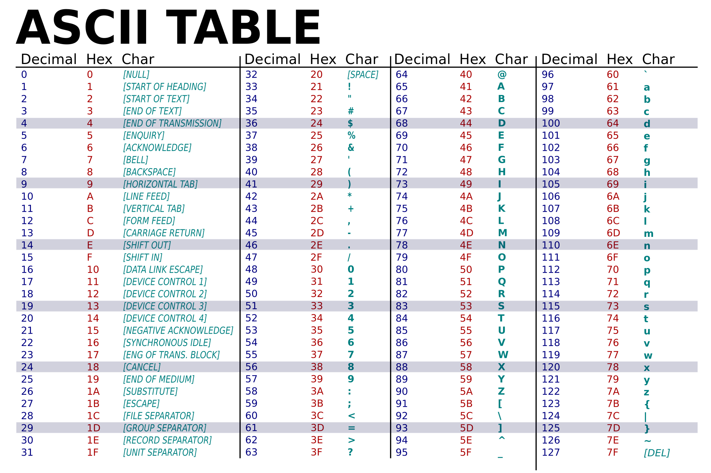
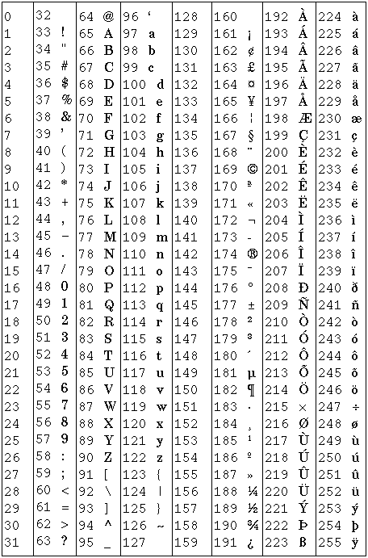

{::nomarkdown}
template: inverse

# Strings

---

# Motivação

## Problema

Um sistema de cadastro pede dados dos clientes, e seu código precisa tratar que:

- Dado o nome completo, ele seja armazenado em caixa alta (maiúsculas);
- O primeiro nome seja reservado separadamente só com a inicial maiúscula;
- CPF e CNPJ possam entrar no mesmo campo e seu tipo tem que ser identificado;
  - XXX.XXX.XXX-XX ou XX. XXX. XXX/0001-XX
- CPF ou CNPJ tenha seus caracteres especiais removidos, se for digitado com eles;
- Sistema só aceite a entrada de data de nascimento no formato “dd/mm/aaaa”;
- Ao final do cadastro, um texto padrão deve ser exibido como “mala direta”.
  - “Sr(a). xxxxx, possuidor(a) do cpf/cnpj xxxxx, nascido(a) no ano de xxxx...”

---

## String

_String_ ou cadeia de caracteres é o tipo de dados 
utilizado para representação textual (palavras, frases, textos) em programas.

```python
print("Hello World")
```

```python
var_str = "Hello World"
print(var_str)
```

- Saída (em ambos os casos):

```
Hello World
```

- Podemos acessar e modificar uma string e seus caracteres utilizando diferentes funções em Python, específicas para as manipulações mais comuns de textos.
- Algumas consultas sobre Strings podem ser realizadas de forma similar às operações com listas (`len(var_str)`, `var_str[indice]`, etc).
  - Strings em Python são imutáveis.

---

## Inicialização de Strings

- Dentro do código:
  - Aspas duplas: `"Hello World"`
  - Aspas simples: `'Hello World'`
  - Aspas triplas: `"""Hello World"""`

Não há diferença entre eles.

Caso o conteúdo da string contenha `"`, pode-se inicializar com `'`, e vice-versa.
Isso e evita o erro abaixo:

```python
var_str = 'Flor d'agua'
print(var_str)
```

```
SyntaxError: invalid syntax (<string>, line 1)
```
---
## Inicialização de Strings

Aspas triplas permitem quebra de linha:

```python
var_str = """Hello
World"""
print(var_str)
```

Saída:

```
Hello
World
```

---

## Inicialização de Strings

A partir da entrada:
  - Entrada

```python
frase = input()
print(frase)
print(type(frase))
```

| Entrada | Saída |
|---|---|
| `"Hello World"` | `Hello World`<br>`<type 'str'>` |

---

## Inicialização de Strings

O caractere especial `\` modifica o uso de outros caracteres 
para ter outra funcionalidade dentro da string:

```python
nome = 'Flor d\'agua'
print(nome)
```

Saída: `Flor d'agua`

--- 

```python
saudacao = "Hello \
World"
print(saudacao)
```

Saída: `Hello World`

--- 

```python
s = "Hello \n World"
print(s)
```

Saída:

```
Hello 
 World
```

--- 

```python
s = "Hello \t World"
print(s)
```

Saída: `Hello 	 World`

---

## Operações básicas

---

## Concatenar strings

Usa-se `+` para criar uma string a partir da concatenação de outras duas:

```python
x = "Alô"
y = "Mundo"
frase = x + " " + y
print(frase)  # Saída: Alô Mundo
```

---

## Verificar se duas strings são iguais

Usa-se `==` para verificar se duas strings são idênticas

```python
s = input()
if s == "sair":
   print("Fim")
```

A condição vai ser falsa se o usuário digitar `"Sair"`, 
pois diferencia-se maiúscula de minúscula.

A condição também vai ser falsa se o usuário digitar `"sair "`, 
pois espaços em branco também são considerados na comparação.

---

## Converter para maiúsculas (upper) ou minúsculas (lower)

Usa-se `upper`/`lower` para converter uma string para maiúsculas/minúsculas:

```python
s = "casa"
print(s.upper())    # Saída: CASA
print("OK".lower()) # Saída: ok
```

Com isso, pode-se aprimorar o exemplo anterior:

```python
s = input()
if s.lower() == "sair":
   print("Fim")
```

---

## Comparar strings quanto à ordem

Usa-se `<`, `>`, `<=` e `>=` para comparar strings quanto à ordem alfabética\*

```python
print("a" <= "b")        # True
print("melão" > "maçã")  # True
```

Se as duas strings começam com o mesmo caractere, 
a comparação continua no segundo caractere, e assim por diante, até encontrar um caractere que seja diferente.

```python
x = input("Digite uma letra maiúscula entre A e J")
if x >= "A" and x <= "J":
   print("Muito bem!")
```

---

# Codificação de caracteres

## Ordem alfabética?

Os exemplos abaixo geram saídas inesperadas:

```python
print("âncora" < "zebra")  # False
print("asa" < "Bola")      # False
```

-Explicação: a forma como os caracteres são representados pelo sistema operacional.
Cada caractere é codificado por um número inteiro. 
A correspondência entre caracteres e números foi padronizada na chamada tabela ASCII.

---



---



---

A tabela ASCII não inclui caracteres acentuados, C cedilha, dentre outros caracteres importantes fora da língua inglesa.

A codificação de caracteres Latin-1 (ver ao lado) estende a tabela ASCII codificando caracteres na faixa de 128 a 255.

Latin-1 também é conhecida como ISO 8859-1

Outra codificação popular é o UTF-8 (do padrão Unicode)

---

## Observações

- Espaço em branco também é um caractere, que possui um código na tabela ASCII
- Maiúsculas e minúsculas possuem códigos diferentes
- Cada versão acentuada de uma letra possui um código diferente
- Existem códigos para quebra de linha, tab, backspace.

---

## ord e chr

Use `ord()` para obter a representação numérica de um caractere:

```python
print(ord("A"))  # 65
print(ord("a"))  # 97
```

Use `chr()` para obter o caractere correspondente a um número:

```python
print(chr(65))  # A
print(chr(97))  # a
```

---

## A comparação se baseia no código numérico dos caracteres

Os operadores `<`, `>`, `<=` e `>=` comparam strings de acordo com 
os códigos numéricos dos caracteres.

```python
print("asa" < "Bola")
```

| a | s | a | |
|---|---|---|---|
| 97 | 115 | 97 | |

| B | o | l | a |
|---|---|---|---|
| 66 | 111 | 108 | 97 |

---

# Acesso a caracteres e substrings

## Comprimento de uma string

Cada caractere é um elemento da string, com um índice específico:

| L | o | g | i | c | a | ␣ | d | e | ␣ | P | r | o | g | r | a | m | a | c | a | o |
|---|---|---|---|---|---|---|---|---|---|---|---|---|---|---|---|---|---|---|---|---|
| 0 | 1 | 2 | 3 | 4 | 5 | 6 | 7 | 8 | 9 | 10 | 11 | 12 | 13 | 14 | 15 | 16 | 17 | 18 | 19 | 20 |

Assim,

```python
disc = "Logica de Programacao"
print(len(disc))
```

tem como saída 21. 

---

## Acesso a um caractere da string

Cada caractere é um elemento da string, com um índice específico:

| L | o | g | i | c | a | ␣ | d | e | ␣ | P | r | o | g | r | a | m | a | c | a | o |
|---|---|---|---|---|---|---|---|---|---|---|---|---|---|---|---|---|---|---|---|---|
| 0 | 1 | 2 | 3 | 4 | 5 | 6 | 7 | 8 | 9 | 10 | 11 | 12 | 13 | 14 | 15 | 16 | 17 | 18 | 19 | 20 |

Os caracteres podem ser acessados individualmente:

```python
disc = "Logica de Programacao"
print(disc[0])
print(disc[7])
print(disc[-1])
```

Saída:

```
L
d
o
```

---

```python
disc = "Logica de Programacao"
print(disc[21])
```

```
IndexError: string index out of range
```

---

## Substrings

Cada caractere é um elemento da string, com um índice específico:

| L | o | g | i | c | a | ␣ | d | e | ␣ | P | r | o | g | r | a | m | a | c | a | o |
|---|---|---|---|---|---|---|---|---|---|---|---|---|---|---|---|---|---|---|---|---|
| 0 | 1 | 2 | 3 | 4 | 5 | 6 | 7 | 8 | 9 | 10 | 11 | 12 | 13 | 14 | 15 | 16 | 17 | 18 | 19 | 20 |

Substrings são trechos da string e podem ser obtidas assim:

```python
disc = "Logica de Programacao"
print(disc[4:13])
print(disc[:6])
print(disc[10:])
```

Saída:

```
ca de Pro
Logica
Programacao
```

Note que o primeiro valor é incluso, mas o segundo não.

---

## Substrings

Cada caractere é um elemento da string, com um índice específico:

| L | o | g | i | c | a | ␣ | d | e | ␣ | P | r | o | g | r | a | m | a | c | a | o |
|---|---|---|---|---|---|---|---|---|---|---|---|---|---|---|---|---|---|---|---|---|
| 0 | 1 | 2 | 3 | 4 | 5 | 6 | 7 | 8 | 9 | 10 | 11 | 12 | 13 | 14 | 15 | 16 | 17 | 18 | 19 | 20 |

O terceiro campo da busca indica o tamanho do “passo”:

```python
disc = "Logica de Programacao"
print(disc[::2])
print(disc[:13:3])
print(disc[::-1])
```

Saída:

```
Lgc ePormco
Li  o
oacamargorP ed acigoL
```

---

## Percorrendo uma string, caractere a caractere

É possível iterar sobre a string:

```python
disc = "Logica"
for char in disc:
    print(char)
```

Saída:

```
L
o
g
i
c
a
```

---

## Busca em strings

```python
disc = "Hello World"
print("H" in disc)
print("L" in disc)
print("x" not in disc)
print("World" in disc)
```

Saída:

```
True
False
True
True
```

- Letras maiúsculas e minúsculas possuem valores diferentes baseados na tabela ASCII.

---

## Busca em strings

| L | o | g | i | c | a | ␣ | d | e | ␣ | P | r | o | g | r | a | m | a | c | a | o |
|---|---|---|---|---|---|---|---|---|---|---|---|---|---|---|---|---|---|---|---|---|
| 0 | 1 | 2 | 3 | 4 | 5 | 6 | 7 | 8 | 9 | 10 | 11 | 12 | 13 | 14 | 15 | 16 | 17 | 18 | 19 | 20 |

Existem métodos para analisar o conteúdo das strings:

```python
var_str = "Logica de Programacao"
print(var_str.find("de"))
print(var_str.find("b"))
```

Saída:

```
7
-1
```

---

```python
var_str = "Logica de Programacao"
print(var_str.count("o"))
print(var_str.count("o", 10))
print(var_str.count("o", 10, 13))
```

Saída:

```
3
2
1
```

---

# Conversões de tipos

## Strings e números

Usa-se `int`/`float`/`str` para converter entre strings e números:

```python
num = int("42")
pi = float("3.14")
s = str(2 + 2)
```

---

## Strings e listas

`list` converte string para lista de caracteres:

```python
s = "Alo"
print(list(s))   # Saída: ['A', 'l', 'o']
```

Para converter de volta, 
use `join` para combinar uma lista de strings em uma única string:

```python
s = ["A", "l", "o"]
print("".join(s))   # Saída: Alo
```

Ao combinar os elementos da lista, 
você pode especificar um caractere ou string para inserir entre os elementos:

```python
print("; ".join(s))  # Saída: A; l; o
print("\n".join(s))  # Saída: (uma letra em cada linha)
```

---

## Strings e listas: split

`split` cria uma lista com as palavras da string (separadas por um ou mais espaços em branco)

```python
s = "Lógica de Programação"
print(s.split())   # Saída: ['Lógica', 'de', 'Programação']
```

Você pode usar outro separador:

```python
s = "uni, duni, tê"
print(s.split(", "))   # Saída: ['uni', 'duni', 'tê']
```

---

# Manipulação de strings

## Strings são imutáveis

Strings em Python são imutáveis (não podem ser modificadas):

```python
frase = "alô Mundo"
frase[0] = "A"
```

```
TypeError: 'str' object does not support item assignment
```

A solução é transformar em lista, fazer a modificação, e então converter de volta para string:

```python
letras = list(frase)
letras[0] = "A"
frase = "".join(letras)
print(frase)    # Saída: Alô Mundo
```

---

## replace

`replace` cria uma cópia da string, 
trocando todas as ocorrências de uma string por outra.
Note que a string original não é modificada:

```python
s1 = "Logica de Programacao"
s2 = s1.replace("Logica", "Mestre")
print(s1)
print(s2)
```

Saída:

```
Logica de Programacao
Mestre de Programacao
```
---

```python
s = "abacate"
print(s.replace("a", "x"))
print(s.replace("a", ""))
```

Saída:

```
xbxcxte
bcte
```

---

## Funções de manipulação de strings

Outras funções básicas de manipulação de strings:

```python
var_str = "Logica de Programacao"
```

| Código | Saída |
|---|---|
| `print(var_str.lower())` | `logica de programacao` |
| `print(var_str.upper())` | `LOGICA DE PROGRAMACAO` |
| `print(var_str.capitalize())` | `Logica de programacao` |
| `print(var_str.title())` | `Logica De Programacao` |

```python
var_str = "   Logica de Programacao   "
```

| Código | Saída |
|---|---|
| `print(var_str.strip())` | `Logica de Programacao` |
| `print(var_str.rstrip())` | `   Logica de Programacao` |
| `print(var_str.lstrip())` | `Logica de Programacao   ` |

---

## Formatação de strings

```python
string = "PI:"
var_str = "Texto %s int %d, float %.2f" % (string, 3.1415, 3.1415)
print(var_str)
```

Saída:

```
Texto PI: int 3, float 3.14
```

```python
var_str = "Texto {} float {}, float {:.2f}".format(string, 3.1415, 3.1415)
print(var_str)
```

Saída:

```
Texto PI: float 3.1415, float 3.14
```

---

A partir do Python 3.6:

```python
var_str = f"Texto {string}, float {3.1415}, float {3.1415:.2f}"
print(var_str)
```

Saída:

```
Texto PI: float 3.1415, float 3.14
```

---

## Consultando métodos

Para ter mais informações sobre métodos:

```python
var_str = f"Texto {string}, float {3.1415}, float {3.1415:.2f}"
print(dir(var_str))
```

```
['__add__', '__class__', '__contains__', '__delattr__', '__doc__', '__eq__', '__format__', '__ge__', '__getattribute__', '__getitem__', '__getnewargs__', '__getslice__', '__gt__', '__hash__', '__init__', '__le__', '__len__', '__lt__', '__mod__', '__mul__', '__ne__', '__new__', '__reduce__', '__reduce_ex__', '__repr__', '__rmod__', '__rmul__', '__setattr__', '__sizeof__', '__str__', '__subclasshook__', '_formatter_field_name_split', '_formatter_parser', 'capitalize', 'center', 'count', 'decode', 'encode', 'endswith', 'expandtabs', 'find', 'format', 'index', 'isalnum', 'isalpha', 'isdigit', 'islower', 'isspace', 'istitle', 'isupper', 'join', 'ljust', 'lower', 'lstrip', 'partition', 'replace', 'rfind', 'rindex', 'rjust', 'rpartition', 'rsplit', 'rstrip', 'split', 'splitlines', 'startswith', 'strip', 'swapcase', 'title', 'translate', 'upper', 'zfill']
```
---

```python
print(help(str.find()))
```

```
Help on method_descriptor:

find(...)
    S.find(sub [,start [,end]]) -> int

    Return the lowest index in S where substring sub is found,
    such that sub is contained within S[start:end].  Optional
    arguments start and end are interpreted as in slice notation.

    Return -1 on failure.
```

--- 

```python
print(help(str))
```

---

# Exemplos de aplicação

## Problema 1

Sistema de cadastro pede dados dos clientes.

- **Dado o nome completo, ele deve ser armazenado em caixa alta;**
- **O primeiro nome deve ser reservado separadamente só com a inicial maiúscula;**
- CPF e CNPJ podem entrar no mesmo campo e seu tipo tem que ser identificado;
  - XXX.XXX.XXX-XX ou XX. XXX. XXX/0001-XX
- CPF ou CNPJ tem seus caracteres especiais removidos, se for digitado com eles;
- Sistema só aceita a entrada de data de nascimento no formato “dd/mm/aaaa”;
- Ao final do cadastro, um texto padrão deve ser exibido como “mala direta”.
  - “Sr(a). xxxxx, possuidor(a) do cpf/cnpj xxxxx, nascido(a) no ano de xxxx...”

---

## Solução

```python
print("Digite nome completo:")
nome_completo = input()
nome_completo = nome_completo.upper()
primeiro_nome = nome_completo.split(" ")[0]
primeiro_nome = primeiro_nome.capitalize()
print(nome_completo)
print(primeiro_nome)
```

---

## Problema 2

Um sistema de cadastro pede dados dos clientes.

- Dado o nome completo, ele deve ser armazenado em caixa alta;
- O primeiro nome deve ser reservado separadamente só com a inicial maiúscula;
- **CPF e CNPJ podem entrar no mesmo campo e seu tipo tem que ser identificado;**
  - **XXX.XXX.XXX-XX ou XX. XXX. XXX/0001-XX**
- **CPF ou CNPJ tenha seus caracteres especiais removidos, se for digitado com eles;**
- Sistema só aceita a entrada de data de nascimento no formato “dd/mm/aaaa”;
- Ao final do cadastro, um texto padrão deve ser exibido como “mala direta”.
  - “Sr(a). xxxxx, possuidor(a) do cpf/cnpj xxxxx, nascido(a) no ano de xxxx...”

---

## Solução

```python
print("Digite CPF ou CNPJ:")
id = input()
if "/" in id:
   tipo_id = "CNPJ"
   id = id.replace("/", "")
else:
   tipo_id = "CPF"
id = id.replace(".", "")
id = id.replace("-", "")
print(tipo_id)
print(id)
```

---

## Problema 3

Um sistema de cadastro pede dados dos clientes.

- Dado o nome completo, armazenar em caixa alta;
- O primeiro nome deve ser reservado separadamente só com a inicial maiúscula;
- CPF e CNPJ podem entrar no mesmo campo e seu tipo tem que ser identificado;
  - XXX.XXX.XXX-XX ou XX. XXX. XXX/0001-XX
- CPF ou CNPJ tem seus caracteres especiais removidos, se for digitado com eles;
- **Sistema só aceita a entrada de data de nascimento no formato “dd/mm/aaaa”;**
- **Ao final do cadastro, um texto padrão deve ser exibido como “mala direta”.**
  - **“Sr(a). xxxxx, possuidor(a) do cpf/cnpj xxxxx, nascido(a) no ano de xxxx...”**

---

## Solução

```python
print("Digite data de nascimento:")
while True:
    data = input()
    if data.count("/") == 2:
        dma = data.split("/")
        if len(dma[0]) == 2 and len(dma[1]) == 2 and len(dma[2]) == 4:
            break
    print("Data no formato incorreto (dd/mm/aaaa)")

# Utilizando informações anteriores
mala_direta = "Sr(a). {}, possuidor(a) do {} {}, nascido(a) no ano de {}...".format(primeiro_nome, tipo_id, id, data[6:])
print(mala_direta)
```

---

## Solução

```python
print("Digite CPF ou CNPJ:")
id = input()
if "/" in id:
    tipo_id = "CNPJ"
    lista_id = id.split("/")
    id = lista_id[0] + lista_id[1]
else:
    tipo_id = "CPF"
lista_id = id.split("-")
id = "".join(lista_id)
lista_id = id.split(".")
id = "".join(lista_id)
print(tipo_id)
print(id)
```

---

## Inicialização de Strings

- Externamente:
  - Entrada

```python
var_str = input()
print (var_str)
print(type(var_str))
```

| Entrada | Saída |
|---|---|
| `"Hello World"` | `Hello World`<br>`<type 'str'>` |

- Linha de Comando

```python
import sys

var_str = "Hello World"
print (var_str)
print(type(var_str))

input_str = sys.argv[1]
print (input_str)
print(type(input_str))
```

```
~$ python teste.py "Segundo Hello World"
Hello World
<type 'str'>
Segundo Hello World
<type 'str'>
```

---

## Concatenação de strings


```python
str_1 = "Logica"
str_2 = "de Programacao"

print(str_1 + str_2)
print(str_1 + " " + str_2)
```

Saída:

```
Logicade Programacao
Logica de Programacao
```

```python
lista = ["Logica", "de", "Programacao"]
var_str = " ".join(lista)
print(var_str)
```

Saída:

```
Logica de Programacao
```

Mais rápido que somas de strings, especialmente para processar muito texto.

{:/}

